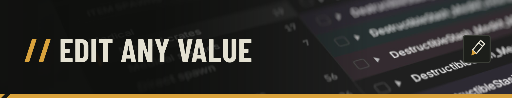
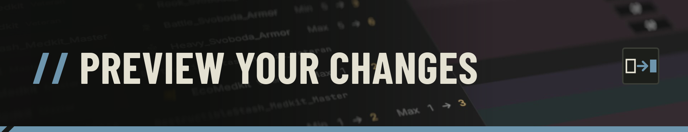

# zoneEDIT

> zoneEDIT is a **desktop** app created with the sole purpose of making
> **modding** more **accessible**.

A desktop app to mod **S.T.A.L.K.E.R. 2** without touching the game files by
hand: change what spawns in the Zone — and how much of it.

## Features

- **Edit** `.cfg` values and export, while **respecting** the documented
  **ZoneKit** folder and file structure
- **Item spawns** — stash & body loot, trader stock, NPC loadouts, quest
  rewards: quantities, spawn chances, weights, ammo counts, weapon durability
- **Stashes** — min/max spawn chance per item and rank
- **Anomalies** — 11 behaviour fields per anomaly (radius, cooldown,
  duration…), with the parent → child hierarchy
- **World artifact spawners** — count, cooldowns, spawn and rarity chances,
  per spawner and rank
- Create **presets** that you can go back to
- **Review** your changes with the **Diff Preview**

## Workflow

1. **Download** the **Lesser ZoneKit** on the **Epic Games Store**
2. Run the ZoneKit **`CreatePlainMod.bat`** followed by your **mod name**
3. **Launch** the **zoneEDIT** release you downloaded
4. **Select** your **STALKER2ZoneKit** folder
5. **Make** your value **changes**
6. **Export** to your newly created mod folder located in
   `STALKER2ZoneKit/Stalker2/Mods/`
7. Run the ZoneKit **`PakPlainMod.bat`**
8. **Install** your mod like usual in `~mods`

### Inside the app

1. **Browse & edit** — filter by name, type, category or rank; edit cells in
   place or in bulk (undo/redo)
2. **Save presets** — reapply your changes at will
3. **Export** — the app writes the modified files to `exports/`; the
   originals are never modified



## Diff Preview

Every change, grouped by item, with the original value next to the new one —
before anything is written.



## Highlights

- **Safe** — the export validates everything before writing; presets refuse
  to apply if the game files are not in the expected state
- **Precise** — only the values you changed appear in the exported files
- **Fast** — tens of thousands of items load in a fraction of a second

## Planned features

- **Adding** more **editable** values, such as **weapon** / **armor** stats
- **Removing** / **adding** / **replacing** items from the spawn logic
- **Automating** the ZoneKit **`.bat`** files execution

## Building from source

```sh
cargo run --release
```

## Bug reports & feature requests

If you find any **bug**, please **report** it on the
[GitHub issues](https://github.com/Chpouky/zoneEDIT/issues). I'd love to hear
about your ideas — open an issue if you wish to contribute.

## Disclaimer

- This tool was **entirely** vibe coded **locally** using Qwen3.8 27B
- This tool was **NOT** generated in an hour or on a whim without
  supervision. **A lot of design decisions and actual human intent was put
  into this tool.** AI was used to generate the **Rust** code I know nothing
  about
