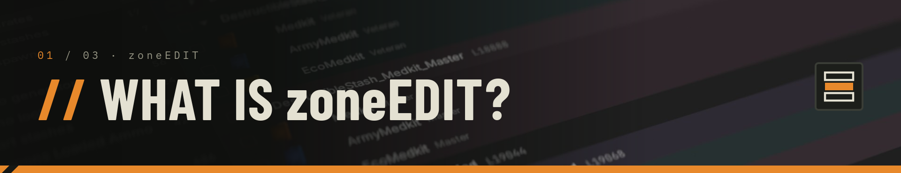
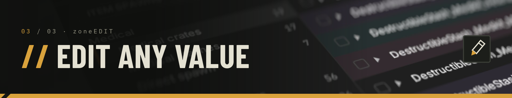
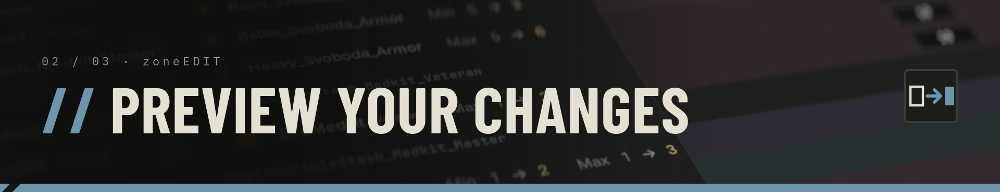

# zoneEDIT

A desktop app to mod **S.T.A.L.K.E.R. 2** without touching the game files by
hand: change what spawns in the Zone — and how much of it.

## What you can edit

- **Item spawns** — stash & body loot, trader stock, NPC loadouts, quest
  rewards: quantities, spawn chances, weights, ammo counts, weapon durability
- **Stashes** — min/max spawn chance per item and rank
- **Anomalies** — 11 behaviour fields per anomaly (radius, cooldown,
  duration…), with the parent → child hierarchy
- **World artifact spawners** — count, cooldowns, spawn and rarity chances,
  per spawner and rank

## How it works

1. **Open your Zone Kit install folder** — `File → Open folder…`
2. **Browse & edit** — filter by name, type, category or rank; edit cells in
   place or in bulk (undo/redo)
3. **Save presets** — reapply your changes at will
4. **Export** — the app writes the modified files to `exports/`; the
   originals are never modified



## Highlights

- **Safe** — the export validates everything before writing; presets refuse
  to apply if the game files are not in the expected state
- **Precise** — only the values you changed appear in the exported files
- **Fast** — tens of thousands of items load in a fraction of a second



## Running the app

```sh
cargo run --release
```
